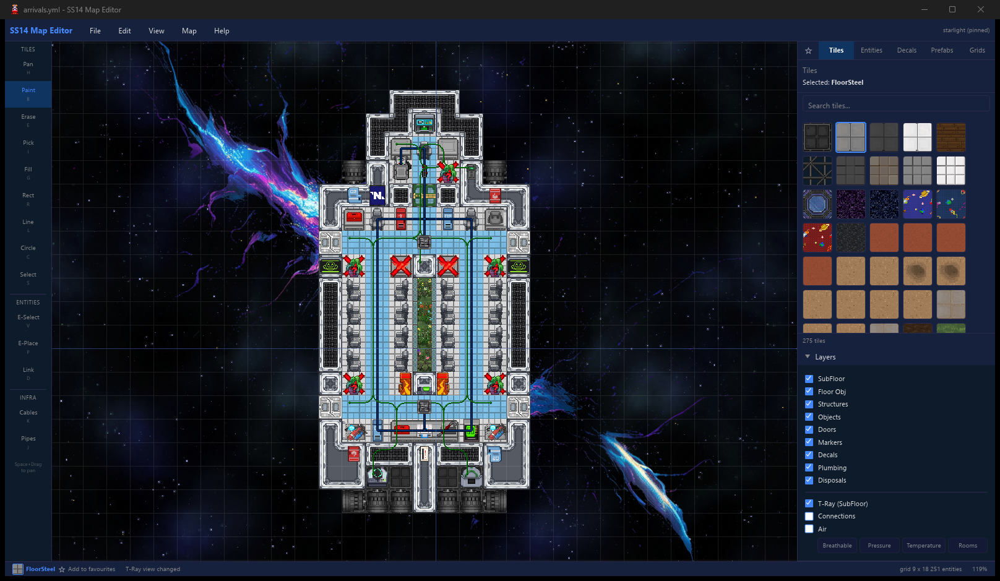
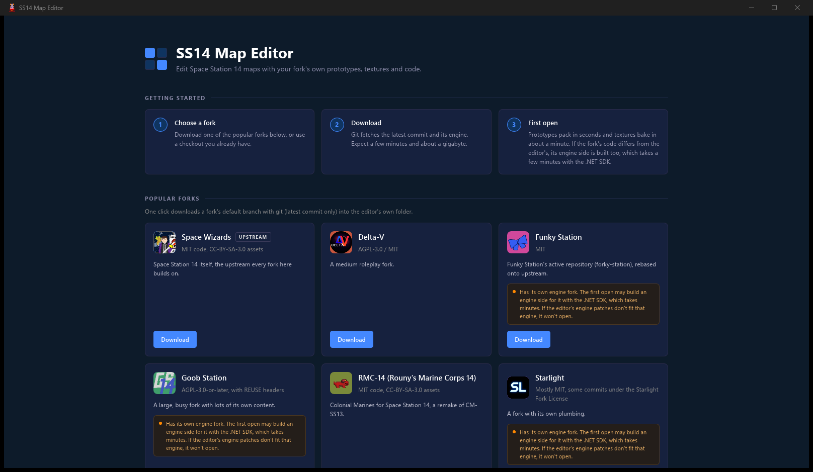

# SS14 Map Editor

A desktop map editor for [Space Station 14](https://spacestation14.com) and its forks.

It runs the game's own engine inside the editor, with your fork's code and content loaded.
The engine holds the map while you work. Every tile you paint, every entity you place and
every file you save goes through the same code the game uses, so a map that looks right in
the editor loads the same way on a server.





## What you can do

- **Open your fork.** Point the editor at a fork you already have, or download a popular one
  from the start screen. It builds whatever that fork's code needs, once.
- **Tools like an art program's**: pick a tool, then what it works on and its shape. Paint
  and Erase work on tiles, entities or decals, at a point or as a line, rectangle, circle,
  lasso or polygon, filled or just the outline. Erase takes what you can see, so hide a layer
  to keep what's on it, or turn on Only to erase just what's in hand. Fill floods an area of
  one tile with a tile, an entity or a decal. R turns the entity you're about to put down.
- **Rooms**: draw a room as a rectangle, ellipse, lasso or polygon and get the floor inside,
  plating and walls round the edge, in one step. Walls already there are never stacked. Turn
  on Join overlapping rooms for hallways and extensions.
- **Select** entities, decals, or with Tiles a region of cells, with a rectangle, ellipse,
  lasso or polygon, or Select same to grab every tile or thing like the one you click. A
  region can be any shape. Copy, cut, paste, turn or delete it with everything on it. Save it
  as a prefab and stamp it onto any map.
- **Decals**, **cables** and **pipes**. Pipes fit themselves to their neighbours as you lay them.
- **Device links**: hook buttons, sensors and alarms up to their devices, edit device lists,
  or auto-link a whole room.
- **Grids**: add, rename and remove grids, and pick the map's backdrop.
- **Air**: an overlay of breathable air, pressure, temperature and rooms. A leak check shows
  where a room is open to space, and the game's own "fix grid atmos" is one menu away.
- **Validate Map** catches common mistakes, like open disposal ends, rooms open to space and
  uneven air. It also finds walls stacked on one cell, the same thing placed twice, and walls
  with no floor under them. Buttons remove the extras or lay plating.
- **Problems** in the Layers panel marks those mistakes on the map as you work. Hover a mark
  to see what is wrong.
- **Layers**, including SubFloor, Plumbing, Disposals and a T-Ray view.
- **Saved state**: doors, valves, filters and lockers look the way the map saved them, and change as you edit them. View > **Animate sprites** sets screens and lights moving. It starts off.
- Entity search, favourites, undo and redo. Help > Controls lists every key.

## Which forks work

The start screen offers these forks as one-click downloads. Any other fork built on Space
Station 14 should work too. Open it from its folder or paste its GitHub URL.

| Fork | Repository | Status |
|---|---|---|
| Starlight | [ss14Starlight/space-station-14](https://github.com/ss14Starlight/space-station-14) | Works. The editor is developed and tested on it, plumbing included. |
| Space Wizards | [space-wizards/space-station-14](https://github.com/space-wizards/space-station-14) | Works. |
| Delta-V | [DeltaV-Station/Delta-v](https://github.com/DeltaV-Station/Delta-v) | Works. |
| Goob Station | [Goob-Station/Goob-Station](https://github.com/Goob-Station/Goob-Station) | Works. |
| Funky Station | [funky-station/forky-station](https://github.com/funky-station/forky-station) | Works. |
| RMC-14 | [RMC-14/RMC-14](https://github.com/RMC-14/RMC-14) | Works. Its `global.json` asks for the .NET 9 SDK. Without it, the editor builds with .NET 10 instead. |

If your fork misbehaves, please [open an issue](https://github.com/SuspensionPoint/ss14-editor-native/issues)
and say which fork and commit you used.

## Install

Grab the zip for your platform from the
[Releases](https://github.com/SuspensionPoint/ss14-editor-native/releases) page.

| Platform | Package |
|---|---|
| Windows | `ss14-editor-windows-x64-<version>.zip` |
| macOS, Apple silicon | `ss14-editor-macos-arm64-<version>.zip` |
| macOS, Intel | `ss14-editor-macos-x64-<version>.zip` |
| Linux (experimental) | `ss14-editor-linux-x64-<version>.zip` |

You also need the [.NET 10 SDK](https://dotnet.microsoft.com/download). The editor runs on the
.NET 10 runtime, which comes with the SDK. The SDK itself is there so the editor can build an
engine side for your fork, which nearly every fork needs the first time you open it.

**Windows.** Unzip the folder and run `ss14-editor.exe` (or `start.cmd`). The build isn't signed, so SmartScreen may
warn you. Click "More info", then "Run anyway".

**macOS.** Unzip the folder. The build isn't signed, so macOS will hold it back until you clear
the quarantine flag. Open a terminal in the folder and run:

```
xattr -dr com.apple.quarantine .
./start.sh
```

You only need the `xattr` line once. After that, `./start.sh` is enough.

**Linux.** Unzip the folder and run `./start.sh`. The Linux build is new and few people have
tried it yet, so please tell us what breaks.

### Trying a pull request's build

Every pull request builds the same packages, so you can try a change before it is merged. On
the pull request, open **Checks**, then the `pr` run, then **Summary**. The zips sit under
**Artifacts**. Each download is a zip holding the package's zip, so unzip twice. You need to
be signed in to GitHub, and the builds are kept for 30 days. [docs/ci.md](docs/ci.md) has the
details, including how to fetch them with the GitHub CLI.

## First run

1. The editor opens on its start screen.
2. Choose a fork. Pick **Use a checkout I have** and select a fork you've already cloned,
   download one of the popular forks, or paste a fork's GitHub URL. Downloads go into the
   editor's own folder: `%LOCALAPPDATA%\ss14-editor` on Windows,
   `~/Library/Application Support/ss14-editor` on macOS, and `~/.local/share/ss14-editor` on
   Linux (or under `$XDG_DATA_HOME` if you set it).
3. The first time you open a fork, the editor gets it ready. It packs the fork's prototypes
   and bakes its textures into one file. If the fork's code differs from the engine side the
   editor shipped with, it also builds a new engine side with `dotnet`, which takes a few
   minutes. Everything lands in a cache, so the next open is quick.
4. Open a map from the recent maps on the start screen, or with File > Open map... (Ctrl+O).

Your fork's checkout is never changed. The editor only reads it and works on copies in its
cache.

## Where the editor keeps things

The editor writes everything it makes into one folder.

| Platform | Folder |
|---|---|
| Windows | `%LOCALAPPDATA%\ss14-editor` (paste it into Explorer's address bar) |
| macOS | `~/Library/Application Support/ss14-editor` (in Finder, press Cmd+Shift+G and paste it) |
| Linux | `~/.local/share/ss14-editor`, or `$XDG_DATA_HOME/ss14-editor` if you set it |

Downloaded forks go in its `forks/` folder, one per fork. Goob Station, for example, lands in
`forks/Goob-Station-Goob-Station`, and its maps sit in that folder's `Resources/Maps/`, which
is where File > Open map... starts looking once you have it open in the editor. Your own
checkouts stay put.

`cache/` holds each fork's packed prototypes, baked textures and engine side. Delete it when
it gets big. Rebuilding an engine side takes a few minutes the next time you open that fork,
so the first open after a clean-out is the slow one.

The rest sits at the top of the folder. `prefabs/` holds your saved prefabs, shared by every
fork, and `backdrops/` keeps the painted space backdrops so they don't need drawing again.
`settings.json` remembers your forks, recent maps and favourites, and `avatars/` holds the
fork pictures on the start screen.

## Building from source

You need [Rust](https://rustup.rs), the [.NET 10 SDK](https://dotnet.microsoft.com/download)
and git. On Linux you also need the system libraries listed as `LINUX_PACKAGES` in
[.github/workflows/pr.yml](.github/workflows/pr.yml).

```
git clone https://github.com/SuspensionPoint/ss14-editor-native
cd ss14-editor-native
git submodule update --init --recursive upstream/starlight
```

The submodule is Starlight at a pinned commit, and it is several GB. The engine side builds
against it by default.

On macOS and Linux, run `tools/run.sh`. It applies the engine patches, publishes the engine
side, builds the editor and starts it. Later runs only redo what changed.

On Windows, run the patch script from Git Bash, then the rest from PowerShell:

```
bash tools/engine-patches.sh apply
cd native
cargo build --release -p ss14-editor
cd ..
.\tools\run.ps1 -Publish
.\tools\run.ps1
```

[CONTRIBUTING.md](CONTRIBUTING.md) covers the tests and checks.
[docs/architecture.md](docs/architecture.md) explains how the pieces fit together.

## Credits

- [Space Station 14](https://github.com/space-wizards/space-station-14) and
  [RobustToolbox](https://github.com/space-wizards/RobustToolbox), by Space Wizards and their
  contributors (MIT). The editor runs the game's engine and content code.
- The forks listed above, whose code and content the editor opens. None of their content ships
  with the editor.
- The clown on the loading screen and in the app icon is Space Station 14 art, licensed under
  [CC-BY-SA 3.0](https://creativecommons.org/licenses/by-sa/3.0/). See
  [native/editor-dioxus/assets/CREDITS.md](native/editor-dioxus/assets/CREDITS.md).
- The interface follows the
  [SS14 web map editor](https://github.com/SuspensionPoint/space-station-14-map-editor) and
  uses its stylesheet (MIT).
- Built with [Dioxus](https://dioxuslabs.com), [Blitz](https://github.com/DioxusLabs/blitz),
  [wgpu](https://wgpu.rs) and [Tailwind CSS](https://tailwindcss.com).

## Licence

The editor's code is under the [MIT licence](LICENSE). The clown art keeps its own CC-BY-SA 3.0
licence.
